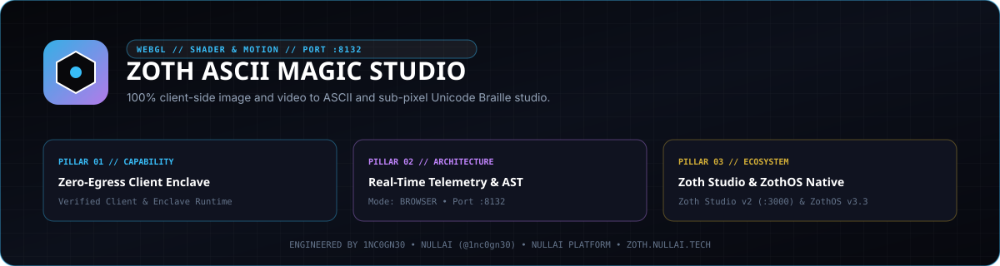

<div align="center">
  
</div>

# Zoth ASCII Magic Studio

**Image, Video & 3D SDF to 24-Bit TrueColor ASCII, Sub-Pixel Unicode Braille, Bayer Dither & Vector SVG Engine (`v2.7.0`)**

- **Zoth Studio Dossier**: [https://zoth.nullai.tech/tools/zoth-ascii-magic](https://zoth.nullai.tech/tools/zoth-ascii-magic)
- **Local Workstation URL**: `http://127.0.0.1:8132`
- **Repository**: [https://github.com/1nc0gn30/zoth-ascii-magic](https://github.com/1nc0gn30/zoth-ascii-magic)
- **Author**: [1nc0gn30](https://1nc0gn30.si) (`@1nc0gn30`) • [NullAI](https://nullai.tech)

## Overview

Zoth ASCII Magic Studio converts images, webcam/video feeds, and procedural 3D signed-distance-field (SDF) scenes into 24-bit TrueColor ANSI terminal streams, standalone HTML `<pre>` blocks, and scalable vector SVGs.

Core capabilities:
- **8 Deterministic Glyph Quantizers**: `ascii`, `braille` (Unicode `U+2800` sub-pixel density), `bayer4` (4x4 ordered Bayer threshold matrix), `bayer8` (8x8 ordered Bayer threshold matrix), `blocks`, `katakana`, `newsprint`, and `hex`.
- **Live WebCam & Video Rasterization**: 60fps in-browser webcam stream quantizer rendering directly into ASCII, Braille, or Bayer matrices with zero cloud latency.
- **TrueColor ANSI Script Exporter**: Exports executable `.sh` shell scripts (`cat << 'EOF'`) containing ANSI 24-bit TrueColor sequences for immediate terminal playback.
- **Sobel Directional Edge Contours**: Computes horizontal ($G_x$) and vertical ($G_y$) Sobel luminance gradients per cell and maps high-gradient structural edges (`> 0.34`) to `/`, `\`, `|`, and `-` contours.
- **7 Procedural 3D SDF Presets & 6 CRT Tube Palettes**: Ships `cyberBust`, `liquidChrome`, `torus4d`, `merkaba`, `datamosh`, `radar`, and `sigil` across `gold`, `amber`, `emerald`, `cyan`, `crimson`, and `neon` phosphor palettes, plus interactive 2D point relighting in the browser workstation.

## Architecture

```text
zoth-ascii-magic/
├── server.py                     # ThreadingTCPServer daemon & REST render API on 127.0.0.1:8132
├── bin/
│   ├── zoth-ascii-magic          # Python CLI synthesizer (SDF/Image -> ANSI, HTML, SVG, JSON)
│   └── zoth-ascii-magic-tui      # Unicode U+2800 Braille sparkline TUI & latency benchmark
├── public/
│   └── index.html                # Client-side Image/Video/3D-to-ASCII & Braille workstation
├── electron/                     # Optional desktop shell wrapper
└── tests/
    └── test_zoth_ascii_magic.py  # Pytest suite for quantizers, SVG generation, and HTTP endpoints
```

## Quickstart

```bash
git clone https://github.com/1nc0gn30/zoth-ascii-magic.git
cd zoth-ascii-magic
python3 server.py --port 8132
```

Open `http://127.0.0.1:8132` in your browser. `server.py` and `bin/zoth-ascii-magic` run on the Python 3 standard library (`Pillow` is optional and only used when rasterizing external `-i/--image` files in the CLI).

## CLI & API Usage

### ZothOS v3.4.0 & Standalone CLI

```bash
# Inspect CLI options and status manifest
./bin/zoth-ascii-magic --help
./bin/zoth-ascii-magic --status

# Render a procedural 3D SDF preset in 24-bit TrueColor Braille or Bayer 8x8
./bin/zoth-ascii-magic --preset merkaba --mode braille --tube neon --cols 72
./bin/zoth-ascii-magic --preset liquidChrome --mode bayer8 --tube cyan --cols 80

# Rasterize a local PNG/JPG/WebP image (uses Pillow if installed)
./bin/zoth-ascii-magic --image sample.png --mode ascii --cols 96

# Export standalone SVG vector art, HTML <pre> block, or JSON descriptor
./bin/zoth-ascii-magic --preset torus4d --mode bayer8 --svg > torus4d.svg
./bin/zoth-ascii-magic --preset sigil --mode katakana --html > sigil.html
./bin/zoth-ascii-magic --preset cyberBust --mode braille --json

# Run the Unicode U+2800 Braille TUI & latency benchmark
./bin/zoth-ascii-magic-tui --json
```

### REST API Endpoints (`127.0.0.1:8132`)

| Method | Endpoint | Description |
| :--- | :--- | :--- |
| `GET` | `/health`, `/api/health` | Daemon health check, version (`2.7.0`), quantizers, and preset list |
| `GET` | `/api/status` | Active quantizers, phosphor palettes, presets, and open-access status |
| `GET` | `/api/render` | Render matrix via query params: `preset`, `mode`, `tube`, `cols`, `no_edge=1`, `no_color=1`, `format=text\|html\|svg` |

Example API call:

```bash
curl -s "http://127.0.0.1:8132/api/render?preset=merkaba&mode=braille&tube=gold&cols=48&no_color=1" | jq .
```

## Testing & Verification

```bash
# Run pytest suite (uses ephemeral port=0)
python3 -m pytest -q

# Verify server & CLI JSON telemetry
python3 server.py --status --json
./bin/zoth-ascii-magic --preset merkaba --mode braille --cols 32 --json
```

## Support

Zoth ASCII Magic Studio is 100% free and open-source with zero paywalls or locked exports. Optional support: [Buy Us a Coffee (Stripe)](https://buy.stripe.com/3cIfZg27PdKo2D64Ocfw40X).

## License

Released under the [MIT License](LICENSE). Copyright (c) 2026 [1nc0gn30](https://1nc0gn30.si) & [NullAI](https://nullai.tech).
