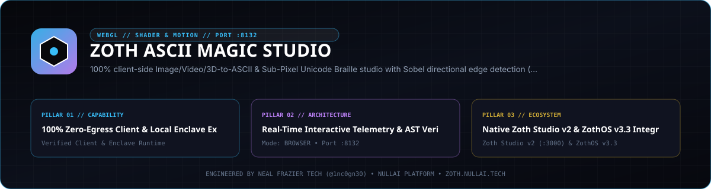
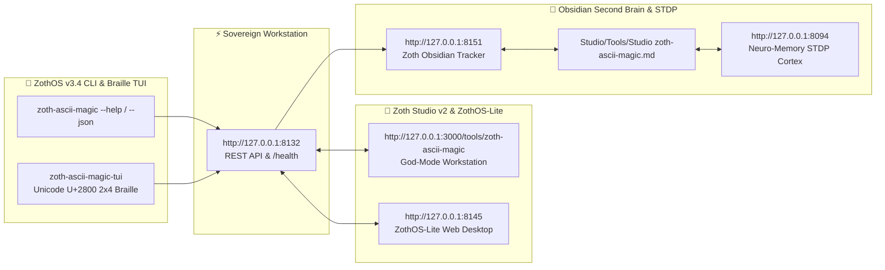

<div align="center">
  
</div>

<br />

<div align="center">
  <a href="https://zoth.nullai.tech/tools/zoth-ascii-magic"></a>
  <a href="https://zothos.nullai.tech"></a>
  <a href="https://nullai.tech"></a>
  <a href="https://buy.stripe.com/3cIfZg27PdKo2D64Ocfw40X"></a>
</div>

# ⚡ Zoth ASCII Magic Studio

> **Avant-Garde Image & 3D to TrueColor ASCII, Bayer Dither, Unicode Braille & SVG Synthesizer.**
> 100% client-side Image/Video/3D-to-ASCII & Sub-Pixel Unicode Braille studio with Sobel directional edge detection (`/\|-`), interactive 2D point relighting, CRT phosphor bloom, and 24-bit TrueColor ANSI/HTML/SVG exports.

---

## 🏛️ Architectural Overview

**Zoth ASCII Magic Studio** is an official sovereign tool in the **[Zoth Studio v2](https://zoth.nullai.tech)** (72-Tool Arsenal) and **[ZothOS Linux 3.3](https://zothos.nullai.tech)** ecosystem, engineered by **1nc0gn30 • NullAI ([@1nc0gn30](https://github.com/1nc0gn30))**.

| Property | Specification |
| :--- | :--- |
| **Tool ID** | `zoth-ascii-magic` |
| **Category** | `Media & 3D` |
| **Loopback Port** | `http://127.0.0.1:8132` |
| **Execution Mode** | `browser` / `python` |
| **Zoth Studio Route** | [`http://127.0.0.1:3000/tools/zoth-ascii-magic`](http://127.0.0.1:3000/tools/zoth-ascii-magic) |
| **ZothOS CLI** | `zoth-ascii-magic`, `ascii-magic`, `ascii` |
| **Access Model** | **100% Free & Open Access (Zero Paywalls)** |

---

## 💎 Key Capabilities

- **Mathematical 3D SDF Shaders**: Procedural 3D raymarching presets including Cyber Bust, Liquid Chrome SDF, 4D Torus Knot, Sacred Merkaba, CRT Datamosh, Perimeter Sonar, and ZothOS Sigil.
- **Ordered Bayer Dithering**: Bayer 4×4 and 8×8 dither matrices for silky 1-bit or multi-level luminance gradients.
- **Sub-Pixel 2×4 Unicode Braille**: Dense sub-pixel packing into Unicode Braille space (`U+2800` to `U+28FF`).
- **Directional Sobel Edge Contours**: Real-time convolution filter calculating luminance gradients and injecting contour glyphs (`/`, `\`, `|`, `-`).
- **Interactive 2D Point Relighting**: Dynamic drag-and-drop light source with real-time specular highlights and rim lighting.
- **Full Spectrum CRT Phosphors**: Sovereign Gold, Amber P3, Emerald P1, Cyber Cyan, Ghost Crimson, and Quantum Neon tubes.
- **Universal Multi-Format Exports**: 24-bit TrueColor ANSI streams (`\x1b[38;2;r;g;bm`), scalable vector SVGs, standalone 60fps HTML/CSS `<pre>` embeds, raw ASCII matrices, and high-res PNG renders.

---

## 🚀 ZothOS CLI & Daemon Usage

```bash
# Check daemon and system status
zoth-ascii-magic --status
zoth-ascii-magic --json

# Procedural 3D ASCII & Braille rendering
ascii -p merkaba -m braille -c 50 --no-color
ascii -p liquidChrome -m bayer8 -c 72 -t emerald
ascii -p torus4d -m ascii -c 60 --svg > torus.svg
ascii -p datamosh -m blocks -c 64 --html > datamosh.html

# Start sovereign web workstation daemon
python3 ~/NullAITech/zoth-ascii-magic/server.py --port 8132
```

---

## ☕ Support 1nc0gn30 • NullAI (Zero Paywalls)

All tools in the Zoth Arsenal are **100% free, open, and unlocked by default**. If you enjoy this tool and want to support continued sovereign development:

- ☕ **Buy Us a Coffee (Stripe)**: [buy.stripe.com/3cIfZg27PdKo2D64Ocfw40X](https://buy.stripe.com/3cIfZg27PdKo2D64Ocfw40X)
- ◎ **Solana Tip Address**: `GG2eQbVh8ut1BK6j1A2tz7pSySdLpD38BgyEhGcxdXoK` (`solana:GG2eQbVh8ut1BK6j1A2tz7pSySdLpD38BgyEhGcxdXoK`)

---

<div align="center">
  <sub>Engineered by <b>1nc0gn30 • NullAI</b> (<a href="https://github.com/1nc0gn30">@1nc0gn30</a>) &bull; <a href="https://nullai.tech">NullAI Platform</a> &bull; <a href="https://zoth.nullai.tech">Zoth Studio v2</a></sub>
</div>

---

## 🏛️ ZothOS v3.4, Zoth Studio v2 & Obsidian Second Brain Ecosystem



### Cross-Surface Integration Matrix

| Surface | Endpoint / Binary | Capabilities |
| :--- | :--- | :--- |
| **Standalone Workstation** | `http://127.0.0.1:8132` | 100% Free & Open-Access Web Deck, live `/health` & REST telemetry |
| **Zoth Studio v2 Route** | `http://127.0.0.1:3000/tools/zoth-ascii-magic` | Interactive God-Mode component inside Zoth Studio (`https://zoth.nullai.tech`) |
| **ZothOS v3.4 CLI & TUI** | `zoth-ascii-magic` / `zoth-ascii-magic-tui` | Global binary in `/usr/local/bin/` with Unicode `U+2800` Braille TUI & `--json` output |
| **ZothOS-Lite Web Desktop** | `http://127.0.0.1:8145` | Browser-native KDE-style window manager & terminal launcher |
| **Zoth Obsidian Tracker** | `http://127.0.0.1:8151` | Interactive Obsidian Second Brain vault explorer (`~/Documents/Obsidian Vault/Studio/Tools/Studio zoth-ascii-magic.md`) |
| **Neuro-Memory STDP Cortex** | `http://127.0.0.1:8094` | 3-Factor STDP synaptic memory daemon & 21-tool MCP server |

```bash
# Inspect CLI & Unicode U+2800 Braille TUI on ZothOS v3.4
zoth-ascii-magic --help
zoth-ascii-magic-tui --status
zoth-ascii-magic-tui --json

# Verify Second Brain Vault & 12-Step Verification Gallery on :8151
zoth-obsidian-tracker --verify
```

